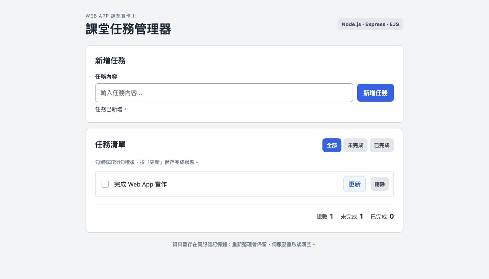
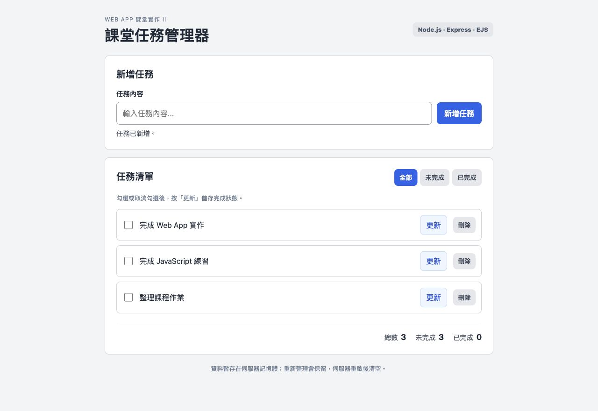
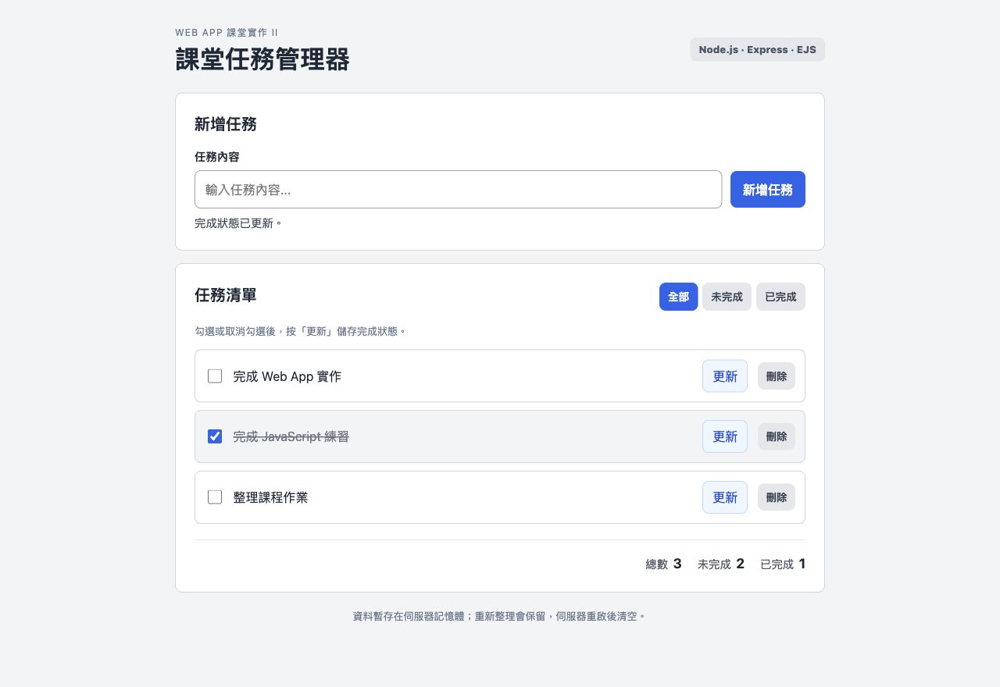
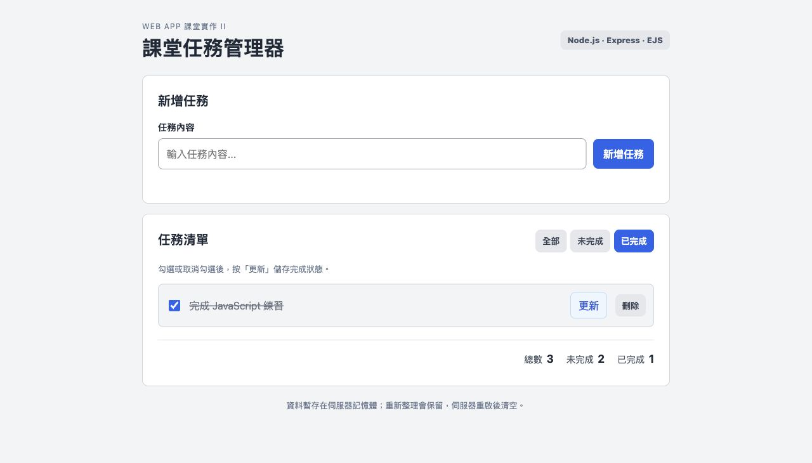
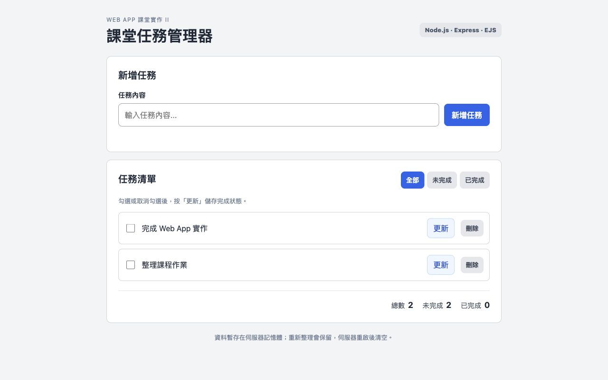
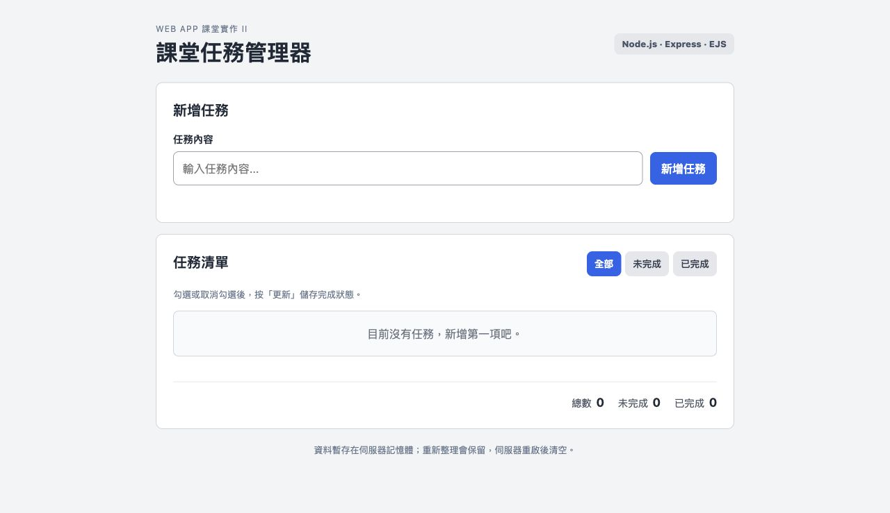
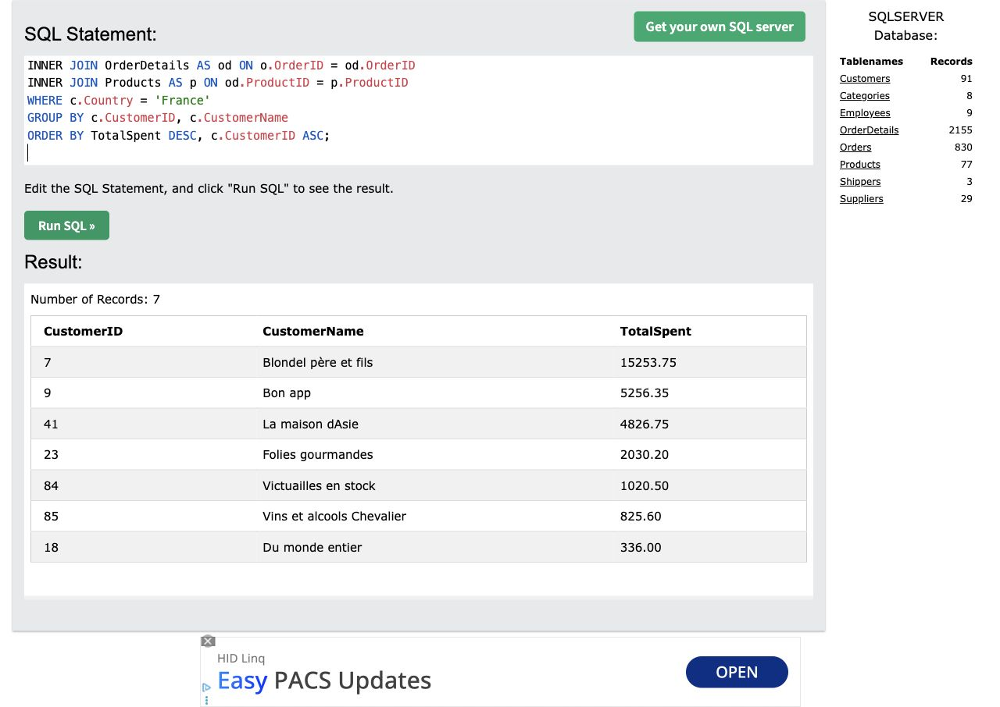
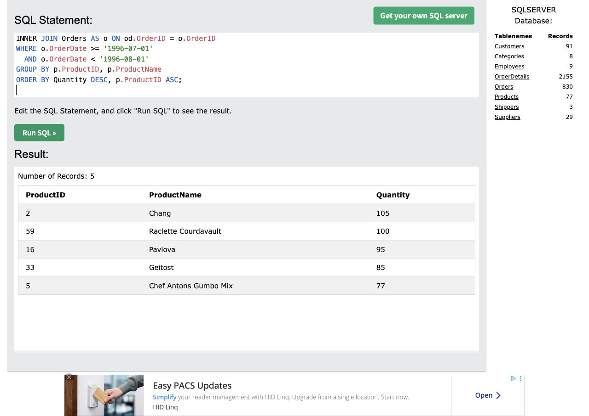
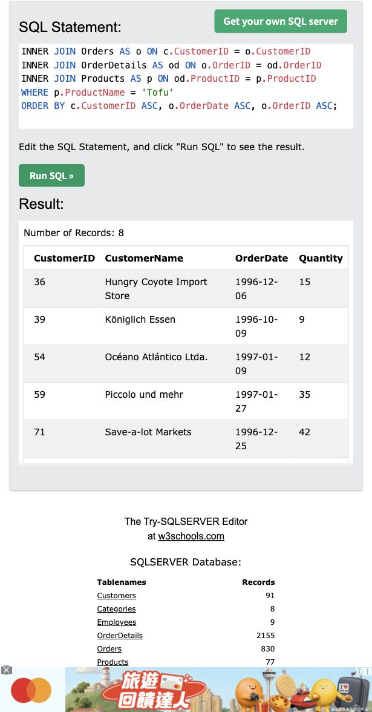
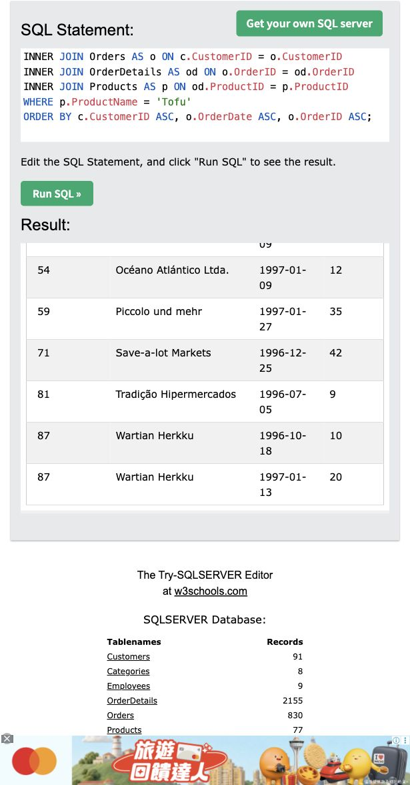

# Web App 個人課堂實作 II

B13901163　電機三　張玟銨
實作日期：2026-11-04　｜　Node.js / Express / EJS / SQL

## A1. 任務管理器與執行方式

延續課堂實作 I 的灰白與藍色介面，將資料及操作搬到伺服器。使用 Express 建立網站，EJS 顯示新增、查看、完成／取消完成、刪除及三種篩選。完成狀態必須勾選後按「更新」才會儲存。

```bash
npm ci
npm start
# Open http://localhost:2234
```

實測環境：Node.js 26.3.0、Express 5.3.0、EJS 3.1.10。server.js 固定監聽本機 2234。資料存在 tasks 陣列，重新整理保留，伺服器重啟清空；不同瀏覽器共用同一份陣列。

## A2. GET 與 POST 的用途

| HTTP | 路徑 | 用途 |
| --- | --- | --- |
| GET | / 或 /?filter=... | 取得完整頁面；all / pending / completed 篩選 |
| POST | /tasks | 解析任務名稱，驗證後新增 |
| POST | /tasks/:id/update | 依固定 ID 設定 completed |
| POST | /tasks/:id/delete | 依固定 ID 刪除指定任務 |

## 為什麼屬於伺服器端產生頁面？

GET 路由把陣列與篩選結果傳給 res.render("index", ...)。EJS 的迴圈在 Node.js 端產生清單 HTML，瀏覽器收到的回應已包含任務內容，不需要執行 renderTasks() 才能看見任務。網站沒有前端 JavaScript，表單仍可操作。

POST 成功後以 303 重新導向 GET（Post/Redirect/Get）。因此刷新頁面只會再次讀取清單，不會重複新增。篩選值放在表單 hidden input，讓修改後回到原篩選。


<!-- page: portrait -->

# A2. 表單資料、陣列與頁面

## 接收表單資料：app.js 第 17 行與第 52-58 行

```javascript
app.use(express.urlencoded({ extended: false, limit: "10kb" }));

app.post("/tasks", (req, res) => {
  const filter = getFilter(req.body.filter);
  const name = typeof req.body.name === "string"
    ? req.body.name.trim() : "";
  if (!name) return renderPage(res, filter,
    "Please enter a task.", true, 400);
  tasks.push({ id: nextTaskId++, name, completed: false });
  redirectToList(res, filter, "added");
});
```

上方為縮短的流程示意；實際程式的訊息為中文，並有 200 字元長度限制。express.urlencoded 將表單轉為 req.body。trim() 去除前後空白，空白輸入回傳 400 並重新顯示頁面。

## 修改陣列：app.js 第 66 行與第 74 行

```javascript
task.completed = req.body.completed === "on";

tasks.splice(tasks.findIndex((item) => item.id === task.id), 1);
```

checkbox 未勾選時不會傳送 completed，故以 === "on" 判斷。明確設定狀態使相同更新重送後仍一致。刪除使用固定 ID，不使用篩選後的顯示索引，所以同名任務或篩選後操作也不會誤刪。

## 重新顯示頁面：app.js 第 24-37 行

```javascript
res.status(status).render("index", {
  tasks: visibleTasks, filter, filterLabels, message, isError, input,
  total: tasks.length, completedCount,
  pendingCount: tasks.length - completedCount
});

res.redirect(303, `/?${new URLSearchParams({ filter, message })}`);
```

統計從完整陣列計算，篩選只決定 visibleTasks。EJS 以跳脫輸出的 <%= task.name %> 顯示名稱，避免輸入被當成 HTML。找不到 ID 時回傳 404，保留其他任務。


<!-- page: landscape -->

# A1 證據 1/5：新增任務




<!-- page: landscape -->

# A1 證據 2/5：查看任務




<!-- page: landscape -->

# A1 證據 3/5：完成任務




<!-- page: landscape -->

# A1 證據 4/5：篩選任務




<!-- page: landscape -->

# A1 證據 5/5：刪除指定任務




<!-- page: portrait -->

# A3. 測試與基本可靠性

執行者：Codex 自動操作本機 HTTP 與 in-app Chromium。以下為本次實際紀錄，不沿用 Task I 的結果。HTTP 整合測試使用 Node 內建 node:test，以獨立 app 啟動隔離伺服器，執行 npm test。

| 測試 | 實際結果 | 判定 |
| --- | --- | --- |
| 空清單 | HTTP 200；顯示提示與 0/0/0；HTML 已有頁面內容 | PASS |
| 新增與刷新 | 名稱 trim；303 導向 GET；重複 GET 不會新增第二筆 | PASS |
| 空白、過長、重複欄位 | 回傳 400，不新增任務 | PASS |
| 完成、重送、取消完成 | 重送相同狀態不反轉；取消後統計恢復 | PASS |
| 篩選後刪除同名任務 | 只移除指定 ID；保留其他任務；最後可回空清單 | PASS |
| 錯誤 ID 與篩選 | 不存在或無效 ID 回 404；其他資料不受影響 | PASS |
| HTML 輸入跳脫 | 輸入 img 字串不會產生圖片元素 | PASS |
| 伺服器重建及未知頁面 | 新 app 陣列為空；未知路徑回 404 | PASS |

HTTP 結果：8/8 通過，0 失敗。原始輸出：evidence/node-test-output.txt。瀏覽器另完成 11 項操作紀錄，包含新增、指定刪除、空清單、純空白驗證、完成與取消、三種篩選、刷新與長名稱。

## 可靠性與驗證範圍

CSS 保留 Task I 的 480px 響應式規則。本次桌面 viewport 實測為 1280px，長名稱可換行且沒有水平溢出。手機尺寸覆寫沒有改變實際 viewport，因此手機 runtime gate 記為 not_performed，不宣稱已完成手機實測。

本作業以單人、本機示範為範圍，沒有資料持久化、帳號或多人隔離。A 題依規定不連接 SQL 資料庫。


<!-- page: landscape -->

# A3 證據：無任務仍正常顯示




<!-- page: portrait -->

# B1. 法國顧客消費總額

執行環境：教師指定 W3Schools SQLSERVER Tryit Editor。三題均實際按 Run SQL，使用網站回傳結果；SQL 指令如下。

```sql
SELECT c.CustomerID, c.CustomerName,
       SUM(p.Price * od.Quantity) AS TotalSpent
FROM Customers AS c
INNER JOIN Orders AS o ON c.CustomerID = o.CustomerID
INNER JOIN OrderDetails AS od ON o.OrderID = od.OrderID
INNER JOIN Products AS p ON od.ProductID = p.ProductID
WHERE c.Country = 'France'
GROUP BY c.CustomerID, c.CustomerName
ORDER BY TotalSpent DESC, c.CustomerID ASC;
```

使用 Customers → Orders → OrderDetails → Products 四張表，依 CustomerID、OrderID、ProductID 連接。WHERE 限定 France，SUM(Price × Quantity) 計算金額，依顧客分組，TotalSpent 遞減排序。本查詢列出有訂單明細的法國顧客；INNER JOIN 不產生無交易顧客的零元列。

## 實際執行結果

| CustomerID | CustomerName | TotalSpent |
| --- | --- | --- |
| 7 | Blondel père et fils | 15253.75 |
| 9 | Bon app | 5256.35 |
| 41 | La maison dAsie | 4826.75 |
| 23 | Folies gourmandes | 2030.20 |
| 84 | Victuailles en stock | 1020.50 |
| 85 | Vins et alcools Chevalier | 825.60 |
| 18 | Du monde entier | 336.00 |

回傳 7 筆。完整查詢與結果截圖見下一頁；可複製的 SQL 另存於 sql/B1_france_total.sql。


<!-- page: landscape -->

# B1. 法國顧客消費總額：網站執行證據




<!-- page: portrait -->

# B2. 1996 年 7 月銷售量前五名

執行環境：教師指定 W3Schools SQLSERVER Tryit Editor。三題均實際按 Run SQL，使用網站回傳結果；SQL 指令如下。

```sql
SELECT TOP 5 p.ProductID, p.ProductName,
       SUM(od.Quantity) AS Quantity
FROM Products AS p
INNER JOIN OrderDetails AS od ON p.ProductID = od.ProductID
INNER JOIN Orders AS o ON od.OrderID = o.OrderID
WHERE o.OrderDate >= '1996-07-01'
  AND o.OrderDate < '1996-08-01'
GROUP BY p.ProductID, p.ProductName
ORDER BY Quantity DESC, p.ProductID ASC;
```

使用 Products、OrderDetails、Orders 三張表。日期採左閉右開區間，包含 7 月 1 日至 7 月 31 日，也適用於日期含時間的欄位。依產品分組加總 Quantity，排序後 TOP 5。數量同分時以 ProductID 遞增決定穩定順序。

## 實際執行結果

| ProductID | ProductName | Quantity |
| --- | --- | --- |
| 2 | Chang | 105 |
| 59 | Raclette Courdavault | 100 |
| 16 | Pavlova | 95 |
| 33 | Geitost | 85 |
| 5 | Chef Antons Gumbo Mix | 77 |

回傳 5 筆。完整查詢與結果截圖見下一頁；可複製的 SQL 另存於 sql/B2_july_top5.sql。


<!-- page: landscape -->

# B2. 1996 年 7 月銷售量前五名：網站執行證據




<!-- page: portrait -->

# B3. 購買 Tofu 的顧客與訂單

執行環境：教師指定 W3Schools SQLSERVER Tryit Editor。三題均實際按 Run SQL，使用網站回傳結果；SQL 指令如下。

```sql
SELECT c.CustomerID, c.CustomerName, o.OrderDate,
       od.Quantity AS Quantity
FROM Customers AS c
INNER JOIN Orders AS o ON c.CustomerID = o.CustomerID
INNER JOIN OrderDetails AS od ON o.OrderID = od.OrderID
INNER JOIN Products AS p ON od.ProductID = p.ProductID
WHERE p.ProductName = 'Tofu'
ORDER BY c.CustomerID ASC, o.OrderDate ASC, o.OrderID ASC;
```

使用 Customers、Orders、OrderDetails、Products 四張表，限定 ProductName = Tofu。每一列保留一筆購買明細，不使用 GROUP BY 或 DISTINCT，避免把同一顧客不同日期的訂單合併。CustomerID 遞增，同顧客再依日期及訂單編號排序。

## 實際執行結果

| CustomerID | CustomerName | OrderDate | Quantity |
| --- | --- | --- | --- |
| 36 | Hungry Coyote Import Store | 1996-12-06 | 15 |
| 39 | Königlich Essen | 1996-10-09 | 9 |
| 54 | Océano Atlántico Ltda. | 1997-01-09 | 12 |
| 59 | Piccolo und mehr | 1997-01-27 | 35 |
| 71 | Save-a-lot Markets | 1996-12-25 | 42 |
| 81 | Tradição Hipermercados | 1996-07-05 | 9 |
| 87 | Wartian Herkku | 1996-10-18 | 10 |
| 87 | Wartian Herkku | 1997-01-13 | 20 |

回傳 8 筆。完整查詢與結果截圖見下一頁；可複製的 SQL 另存於 sql/B3_tofu_orders.sql。


<!-- page: landscape -->

# B3. 購買 Tofu 的顧客與訂單：網站執行證據




<!-- page: landscape -->

# B3. Tofu 訂單：結果區後段




<!-- page: portrait -->

# B. 結果交叉驗證與資料範圍

指定環境：https://www.w3schools.com/sql/trysqlserver.asp?filename=trysql_func_sqlserver_cast

## 不只確認 SQL 能執行

另外在同一編輯器執行 verification-detail.sql，取得尚未 GROUP BY 的顧客、國家、訂單、日期、產品、單價及數量。網站實際回傳 518 筆連接明細，由 JavaScript 獨立篩選、彙總、排序，逐列比對 B1、B2、B3。

| 查詢 | 獨立重算與檢查 | 結果 |
| --- | --- | --- |
| B1 | 篩選 France，以整數分計算每列單價乘數量，再依顧客加總及排序；7 筆完全一致。 | PASS |
| B2 | 篩選完整 1996 年 7 月，依 ProductID 加總數量及取前五；105、100、95、85、77 完全一致。 | PASS |
| B3 | 篩選 ProductName 為 Tofu，保留每筆明細及日期；8 筆欄位與排序完全一致。 | PASS |

交叉驗證時間（Asia/Taipei）：2026-11-04 14:35:59。驗證查詢及原始結果保留於 sql/verification-detail.sql、evidence/sql-detail.json、evidence/sql-results.json、evidence/sql-verification.json。

## 資料範圍與解讀

八張表中，這三題只需要 Customers、Orders、OrderDetails、Products；Categories、Employees、Shippers、Suppliers 不影響要求的欄位。額外連接無關表格沒有必要，也可能增加錯誤或重複計算風險。

消費金額完全依題目指定的 Products.Price × OrderDetails.Quantity 計算，沒有另外引入折扣或歷史價格。網站側欄的靜態表筆數與本次查詢實際回傳資料範圍不同；本報告採實際查詢回傳值，沒有從其他 Northwind 資料版本拼補結果。

## 來源

Task I：https://github.com/WenAnChang19/task-manager-classwork
本次 repo：https://github.com/WenAnChang19/task-manager-classwork-ii
Express：https://expressjs.com/en/5x/api/
EJS：https://ejs.co/
Node 測試器：https://nodejs.org/api/test.html


<!-- page: portrait -->

# C1. AI 對話紀錄：後端表單

使用工具：OpenAI Codex。以下保留本聊天真實問答節錄，處理與驗證均標明執行者，沒有把事後整理的問題冒充學生原話。

## 遇到的問題

將 Task I 的瀏覽器端陣列及手動 DOM 更新改成 Express/EJS，並確定完成任務的表單提交方式。

## 學生提問與決定（實際節錄）

「這是task1的repo 先跟我確認所有你覺得需要釐清的技術細節」
確認操作方式時回覆：「保留 採勾選後按更新」。

## AI 回覆（實際節錄）

「這次要把任務資料與處理邏輯搬到 Express，透過 EJS 產生頁面。」
「完成狀態採『勾選後按更新』的表單方式，讓每次操作都能清楚對應後端 POST」。

## 採用與處理方式

學生選擇沿用介面並採勾選後按更新。Codex 依此實作伺服器 tasks、POST 更新、303 導向 GET 及 EJS。更新以 req.body.completed === "on" 明確指定狀態，不直接把布林值反轉，避免重送導致再次切換。

## 驗證結果

Codex 瀏覽器操作確認：只勾選時已完成數仍為 0，按更新才變成 1；取消勾選後按更新可恢復。HTTP 測試另驗證相同更新重送仍維持已完成。證據為 A1-complete.jpg、browser-tests.json 的 UI04/UI10，以及 node-test-output.txt。

更完整的合作節錄與來源說明見 docs/AI_COLLABORATION.md。


<!-- page: portrait -->

# C1. AI 對話紀錄：SQL 驗證

## 遇到的問題

必須從八張表選出正確關聯，並在教師指定環境實際執行，不能只提交看似正確的 AI 指令。

## 學生提供的要求（實際訊息節錄）

「SQL 指令必須實際執行，不能只提交看起來合理的指令。」
「請注意：必須正確地從八個資料表選出適當的資料表、連接與篩選。」

上述文字是學生貼上的教師要求，並非另行提出的除錯問題。

## AI 回覆（實際節錄）

「先確認實際環境支援的語法，再決定前五筆及日期條件寫法。」
執行後回報：「三題 SQL 已在指定網站執行成功：B1 回傳 7 筆、B2 回傳 5 筆、B3 回傳 8 筆。」

## 採用與處理方式

Codex 在指定網站執行三題，B2 使用該環境可執行的 TOP 5 與完整月份區間。為避免查詢能跑但連接或彙總錯誤，另查出未彙總明細，以 JavaScript 重算三題並比對。沒有把這些操作寫成學生親自執行。

## 驗證結果

518 筆明細重算後，三題欄位、排序及數值一致。B1 使用整數分避開 JavaScript 浮點誤差。截圖、原始明細及比對紀錄均保存在 evidence/。


<!-- page: portrait -->

# C2. 學習反思

以下由 AI 依本次實際開發與驗證過程協助撰寫，參考 Task I 的精簡風格。這是供學生閱讀、核對的草稿；個人理解與感受尚未由學生確認。

## 1. 本次實作最困難的部分及解決方式

本次最需要注意的是資料與畫面更新的位置。Task I 在瀏覽器修改陣列後呼叫 renderTasks()，這次則需要由表單把資料送到 Express，再由 EJS 產生新的 HTML。可以沿著「表單欄位 → req.body → 修改 tasks → 303 → GET → res.render」逐步追蹤，確認每一個功能在哪裡發生。SQL 則先畫出顧客、訂單、明細、產品的關聯，再決定分組及篩選條件，避免把同一張訂單的金額重複計算。

## 2. AI 建議是否需要調整？

AI 的建議需要配合這次題目及操作選擇調整。例如不能直接保留 Task I 勾選後只更新瀏覽器陣列的方式；這次選擇「勾選後按更新」，所以完成狀態必須由 POST 傳到後端。未勾選的 checkbox 不會送出 completed 欄位，因此需要明確判斷是否等於 "on"。SQL 也不能只看編輯器名稱就假設所有語法可用，而要以指定網站實際執行結果為準。

## 3. 如何確認程式與 SQL 正確？

程式驗證同時採用 HTTP 測試及真實瀏覽器操作，除了正常新增、刪除與空清單，也確認篩選後刪除指定 ID、取消完成、刷新不重複新增及 HTML 跳脫。SQL 除了查看執行截圖，還使用同一環境的未彙總明細重算，逐筆比對三題結果。這些測試由 Codex 執行；提交前仍應自行操作網站並能說明各路由及 SQL 的連接與分組用途。

## AI 協助範圍與繳交說明

Codex 協助程式生成、除錯、測試、SQL 執行、截圖、報告與 repo 整理。學生提供題目、原 repo、介面及提交方式選擇。依規範繳交本 PDF 與獨立程式 ZIP；ZIP 不包含 node_modules，使用 npm ci 安裝依賴。規範沒有要求公開部署，網站於 localhost:2234 執行。
